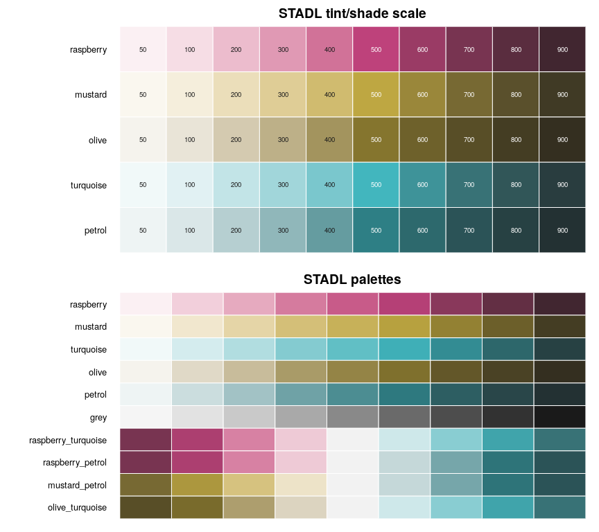

<!-- README.md is generated from README.Rmd. Please edit that file -->

# stadlColorPaletteR

<!-- badges: start -->

<!-- badges: end -->

stadlColorPaletteR provides a complete color palette based on the five
STADL brand colors, ready to use with ggplot2 and plotly:

  - a **tint/shade scale** (`50` to `900`, `500` = brand color) for
    every base color,
  - **sequential** palettes for ordered and continuous data,
  - **diverging** palettes for data around a meaningful center,
  - **ggplot2 scales** (`scale_colour_stadl()`, `scale_fill_stadl()`)
    and **plotly colorscales** (`stadl_colorscale()`).

## Installation

You can install the development version of stadlColorPaletteR from
[GitHub](https://github.com/) with:

``` r
# install.packages("devtools")
devtools::install_github("thgsponer/stadlColorPaletteR")
```

## Documentation

Full documentation website on:
<https://thgsponer.github.io/stadlColorPaletteR>

## The colors

``` r
library(stadlColorPaletteR)

stadl_colors()
#> raspberry   mustard     olive turquoise    petrol 
#> "#BE427B" "#BEA742" "#85752E" "#42B6BE" "#2E7F85"
stadl_colors("raspberry", c(100, 700))
#> raspberry_100 raspberry_700 
#>     "#F6DDE5"     "#783451"
stadl_palette_names()
#>  [1] "raspberry"           "mustard"             "turquoise"          
#>  [4] "olive"               "petrol"              "grey"               
#>  [7] "raspberry_turquoise" "raspberry_petrol"    "mustard_petrol"     
#> [10] "olive_turquoise"
stadl_pal("turquoise", n = 5)
#> [1] "#F1F9F9" "#B1DDE0" "#61BFC5" "#338C93" "#274143"
```

``` r
show_stadl_palettes()
```



## ggplot2

``` r
library(ggplot2)

# categorical data
ggplot(iris, aes(Sepal.Width, Sepal.Length, colour = Species)) +
  geom_point(size = 2) +
  scale_colour_stadl("turquoise", discrete = TRUE)

# continuous data, sequential palette
ggplot(faithfuld, aes(waiting, eruptions, fill = density)) +
  geom_raster() +
  scale_fill_stadl("raspberry")

# data around a center, diverging palette (neutral color at midpoint)
ggplot(df, aes(x, y, fill = change)) +
  geom_tile() +
  scale_fill_stadl("raspberry_turquoise", midpoint = 0)

# the brand colors as manual values
ggplot(mpg, aes(class, fill = drv)) +
  geom_bar() +
  scale_fill_manual(values = unname(stadl_colors(c("raspberry", "mustard", "petrol"))))
```

## plotly

``` r
library(plotly)

# discrete colors
plot_ly(iris, x = ~Sepal.Width, y = ~Sepal.Length, color = ~Species,
        colors = stadl_colors(), type = "scatter", mode = "markers")

# continuous color mapping
plot_ly(iris, x = ~Sepal.Width, y = ~Sepal.Length, color = ~Petal.Length,
        colors = stadl_pal("turquoise"), type = "scatter", mode = "markers")

# traces with a colorscale (heatmap, contour, surface, ...)
plot_ly(z = volcano, type = "heatmap",
        colorscale = stadl_colorscale("raspberry"))
```
